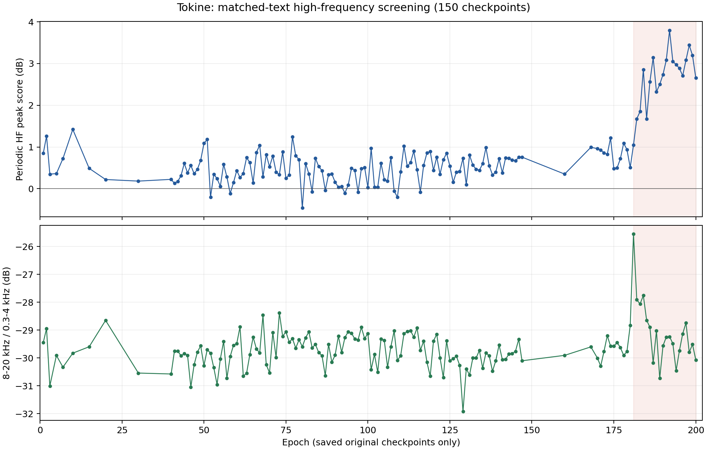
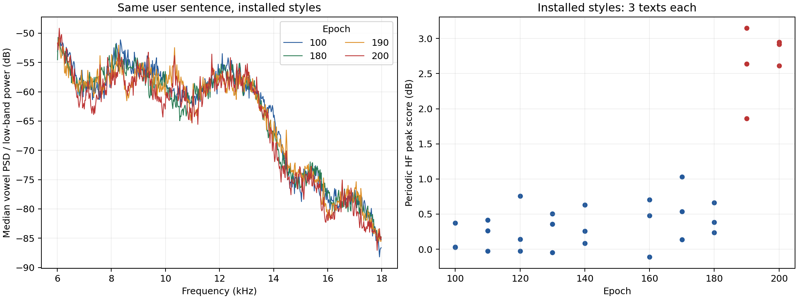

# 花園トキネ 全epoch高域ノイズ検査（2026-10-21）

190・200epochには、100〜180epochより強い周期的な高域ピークが確認できました。高域全体の音量が増えた形ではなく、細いピークが櫛状に並ぶ形です。本人の「高音のノイズが多い」という指摘に対応する候補が見つかりました。

## 検査範囲

保存されている原本150モデルを同じ1文で検査し、原本への追加13文と、現在登録中の20スタイル×3文を合わせ、223本を生成・解析しました。全WAVで有限値・非無音・PCMクリップ0を確認。保存原本・登録設定・配布モデルは変更していません。1〜7epochの解除済みモデルも、検査用エンジンだけで解析しました。

原本が手元にないepochは未検査です：4, 6, 8, 9, 11, 12, 13, 14, 16, 17, 18, 19, 21, 22, 23, 24, 25, 26, 27, 28, 29, 31, 32, 33, 34, 35, 36, 37, 38, 39, 148, 149, 150, 151, 152, 153, 154, 155, 156, 157, 158, 159, 161, 162, 163, 164, 165, 166, 167, 169。存在しないモデルの結果を補間・推定していません。

## 主な結果

- 保存原本の共通文では、100〜180epochの周期ピーク指標の中央値は0.60dB、181〜200epochは2.80dBでした。
- 182〜184epochごろから増える傾向が見られ、185epochなど一時的に弱いモデルもあります。共通文で最大だったのは192epoch（3.79dB）です。200epochだけの現象ではありません。
- 登録中の190・200epochでは、3文すべてで100〜180epochより強い周期ピークを確認しました。約7.58kHz、8.27kHz、10.34kHz、11.03kHzなどに現れます。文やモデルによって突出位置は変わります。
- 補正前の190・200epoch原本にも同じ傾向があります。10/20の音量補正だけで発生した現象ではありません。学習中に何が引き金になったかは今回の検査では確定していません。
- 広帯域の高域比率は200epochの方が大きいわけではありません。高域の総量だけでノイズの多少を判断すると、今回の違いを見落とします。

登録済みスタイル、3文平均。周期ピーク指標は周辺周波数に対する突出の度合いであり、ノイズ量・S/N比そのものではありません。

| epoch | 周期ピーク指標（dB） | 母音中の8〜20kHz／0.3〜4kHz（dB） |
|---|---:|---:|
| 100 | 0.14 | -27.61 |
| 110 | 0.22 | -28.57 |
| 120 | 0.29 | -27.70 |
| 130 | 0.27 | -27.79 |
| 140 | 0.32 | -27.84 |
| 160 | 0.36 | -27.82 |
| 170 | 0.57 | -28.06 |
| 180 | 0.43 | -28.04 |
| 190 | 2.55 | -27.96 |
| 200 | 2.83 | -28.54 |





## 検査条件と計算

COEIROINK 2.13.0、CPU、話速1。44.1kHz・16bit・monoの加工前predict_with_duration出力を使用。補正前の保存原本は独立した検査用エンジンで読み込み、現在のアプリのモデル登録には加えていません。181epoch以降は同時期のconfig_181-200.yamlを使用。47音素の対応表が旧モデル用と異なる点も反映済みです。

共通文は「あー、いー、うー、えー、おー。今日はいい天気ですね。」。追加文は本人が指摘した「迷惑かけちゃってごめんね、こんなに長く外にいるつもりはなかったんだよ」と、旅行・切符の比較文です。

STFTは2048サンプル、hop512、Hann窓。APIの音素区間から母音a/i/u/e/oの中央部分を選び、境界から25msを除外。摩擦音そのものを高域ノイズと誤認しにくい条件にしました。母音区間のフレームごとに0.3〜4kHzのエネルギーで正規化し、音量差を除いたスペクトルの中央値を計算しています。

原本190・200の予備比較で、約689.06Hz間隔の周期ピークが見られました。その第10〜26倍（約6.89〜17.92kHz）について、中心ビンと周囲の中央値との差を平均したものが周期ピーク指標です。周囲には中心±3〜7ビンを使用しています。これは今回の現象を追うための指標で、事後に選んだ観測指標です。追加文・登録済みスタイルの3文でも傾向を確認しました。人工的に周期成分を加えた検証では、背景のみ0.06dB、周期成分あり27.09dBとなり、検出方向を確認できました。

この数値だけで、すべての高域成分をノイズと確定したり、声質の良さを順位付けしたりはできません。すべての文章・調声・再生環境で同じ差が出る保証もありません。今回の対照条件では、ノイズを抑えて使う候補として100〜180epochを優先する根拠があります。

## 成果物

- [全epochの詳細CSV](all_epoch_noise_metrics.csv)：原本・登録版・文章別の223行。
- [要約JSON](summary.json)、[原本150モデルのハッシュ](model_hashes.json)。
- 試聴用の同音量比較音声はローカルに保存。100→180→190→200epochの順で、一定の線形ゲインだけで約−23LUFSへ合わせました。ノイズ除去・EQ・リミッターは使用していません。
- 各WAV・APIの音素区間・リクエストはローカルのoriginal/とinstalled/に保存。公開リポジトリには含めません。
- グラフの編集可能な原稿はepoch_noise_overview.svgとhf_comparison.svg。

今後ノイズ対策を試す場合は、まず180epochなどとの同音量比較を基準にします。今回の依頼は検査のため、モデルや配布ZIPの差し替え、ノイズ除去は実施していません。

## 再現用スクリプト

この検査用のMac手順は、COEIROINK 2.13.0の導入済みエンジンと手元のモデルを使います。実行前に50033番ポートが空いていることを確認してください。検査先には新しい専用フォルダを指定します。アプリ内のエンジンや登録ファイルは書き換えず、専用フォルダ内だけに検査用コピー・シンボリックリンクを作成します。検査用コピーは外部へ配布しません。

```sh
uv run --python 3.10 --with pyinstaller python tools/prepare_noise_engine.py --root /path/to/audit --models /path/to/models
/path/to/audit/runtime/engine/engine
```

エンジンを起動したまま別のターミナルで実行します。modelsにはepoch名のpthと、学習時に対応したconfig.yaml / config_181-200.yamlが必要です。

```sh
uv run --python 3.10 --with numpy --with scipy python tools/noise_audit.py --root /path/to/audit --texts vowels
uv run --python 3.10 --with numpy --with scipy python tools/noise_audit.py --root /path/to/audit --epochs 100 180 190 200 --texts user
uv run --python 3.10 --with numpy --with scipy python tools/noise_audit.py --root /path/to/audit --epochs 180 181 182 185 190 200 --texts user travel
uv run --python 3.10 --with numpy --with scipy python tools/noise_audit.py --root /path/to/audit --installed --port 50032 --epochs 10 15 20 30 40 50 60 70 80 90 100 110 120 130 140 160 170 180 190 200 --texts vowels user travel
uv run --python 3.10 --with numpy --with scipy python tools/noise_spectral_detail.py --root /path/to/audit
uv run --python 3.10 --with numpy --with scipy --with matplotlib python tools/noise_report.py --root /path/to/audit
```

今回のモデル群・登録スタイルに合わせた検査スクリプトです。別の環境では実在するepoch、話者UUID、styleId、音素対応表に合わせる必要があります。既存結果がある組み合わせは再生成せず再利用します。モデル・設定を変更して再検査するときは、新しい検査フォルダを使ってください。生成の細部には実行間の差があるため、公開数値とのビット単位の一致は保証しません。
