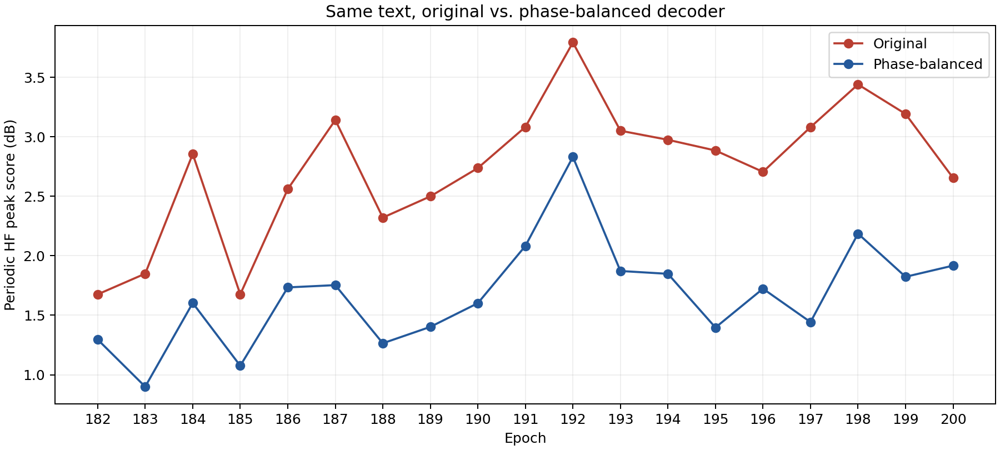

# 182〜200epochの高域ノイズ対策（2026-10-21）

182〜200epochの19モデルに推論用の補正版を作成しました。Macで登録中の190・200epochとサンプル各3本は補正版へ更新済みです。COEIROINK再起動後も20スタイルを確認し、190・200の実出力4本が検証用エンジンの採用版とPCM完全一致しました。作業中の2文と調声も復元しました。波形生成器の第2アップサンプル層を補正し、約689Hz間隔で高域に現れていた周期ピークを減らしています。元の学習モデルは保持しています。

## 原因と分かった範囲

200epochの波形生成器だけを180epochのものに交換すると、本人指定文の周期ピーク指標は2.93から0.49dBへ低下しました。逆に180epochへ200epochの波形生成器を入れると0.24から3.98dBへ増加しました。200epochの第2アップサンプル層だけを180epochへ交換した場合は1.00dBでした。高域ピークの直接の発生箇所は、音素を読む処理より後段の波形生成器、特にこの層に絞れます。[介入実験一覧](interventions.csv)

このモデルの[ESPnet HiFiGAN実装](https://github.com/espnet/espnet/blob/v.202511/espnet2/gan_tts/hifigan/hifigan.py)は、8・8・2・2・2倍の転置畳み込みで波形を生成します。第2層では8位相間のDC応答に差があり、44,100÷64＝689.0625Hzとその倍音の周期成分が現れます。位相間の応答差を部分的に揃える介入で、該当する高域ピークが減りました。

学習履歴にも異常がありました。181epoch再開時、ESPnetの設定が202211から202511へ変わり、音素対応表47項目中27項目の位置が変わっていました。保存済みの実学習ログには、optimizerのパラメータグループ不一致で状態復元に失敗し、fresh optimizerで継続した警告があります。Antigravityの作業履歴でも、復元エラーを捕捉して継続する変更を確認しました。正常な状態をそのまま引き継いだ再開ではありません。

ただし、設定変更・音素対応・optimizer復元失敗の寄与を分離する再学習実験はしていません。このうち一つだけを歴史的な原因と断定できず、両optimizerが初期化されたとも確認していません。担当AIモデルの交代そのものを原因とする証拠はありません。今後の再学習では、180epoch時点の実装・設定・音素対応を固定し、optimizer復元失敗を無視せず停止する必要があります。

## 採用した補正

第2層の各位相のDC応答を、全位相の平均へ**半分だけ**近づけました。重み正規化を再構成し、1,049テンソルのうち対象層の2テンソルのみ変更しています。それ以外の1,047テンソルは保存後に元と完全一致を確認しました。ただし対象層の実効重みの変化は約26%あり、「2テンソルだから微小な変更」とは扱いません。

完全に揃える強い補正では、200epochの語尾「んだよ」のWhisper認識結果に変化が出たため採用しませんでした。採用版は元と同じ「んだよ」と認識されました。190epochの同じ語尾は元から「んだろう」と認識され、採用版でも残ります。音声認識は補助検査であり、自然さや声質の完全な維持を証明するものではありません。

波形へのローパス、EQ、ノイズ除去は使っていません。既存モデルから作った推論専用の派生モデルです。正常な学習状態を復元した200epochでも、追加学習したモデルでもありません。学習再開用checkpointに使わないでください。

## 検証結果

182〜200epoch全19モデルを、母音・本人指定文・旅行文の3文ずつ、計57WAVで検証しました。登録版190・200epochは従来の音量補正を維持したまま、別途5文ずつで比較しました。

| 登録版 | 補正前の周期ピーク指標 | 補正後 |
|---|---:|---:|
|190epoch・5文平均|2.40dB|1.36dB|
|200epoch・5文平均|2.81dB|1.72dB|

登録版10組の比較で、全組の周期ピーク指標が低下。音素区間と発話時間は元と一致し、音量差は−0.10〜−0.01 LUFSでした。補正後true peak最大−0.75dBTP、PCMクリップ0。波形相関の最小値は0.991でした。高域ピークは残っており、100〜180epochと同等の無雑音や、任意の文章での品質は保証していません。



この指標は約689Hzの第10〜26倍について、母音区間で中心ビンが周辺帯域より突出する度合いを平均したものです。ノイズ量・S/N比・声質の総合点ではなく、dB差をそのまま「ノイズ何%減」と解釈できません。条件と限界は[前回の検査報告](../noise-audit-20261021/README.md#検査条件と計算)を参照してください。

## 成果物・再現

- [19モデル×3文の結果](corrected_epochs.csv)、[登録版10組の詳細](installed_pairs.csv)、[要約](summary.json)
- [原本と補正版のハッシュ](final_manifest.json)
- [補正スクリプト](../../tools/balance_upsampler_phases.py)。元モデルとは別の新規パスへ一度だけ適用します。既に高域補正したモデルへ重ねて適用しません。

```sh
uv run --python 3.10 --with torch python tools/balance_upsampler_phases.py \
  /path/to/original/200epoch.pth /path/to/corrected/200epoch.pth --amount 0.5
```

入力の取り違えを防ぐ場合は`--expected-sha256`を指定してください。学習時の音素対応表と設定を維持し、COEIROINKで再生成して検査します。今回の182〜200epoch原本にはconfig_181-200.yamlを使用しました。

音声・モデル・生ログはこのソースリポジトリには含めません。GitHub Release v1.1.1の配布ZIPは今回の高域補正前のままです。
