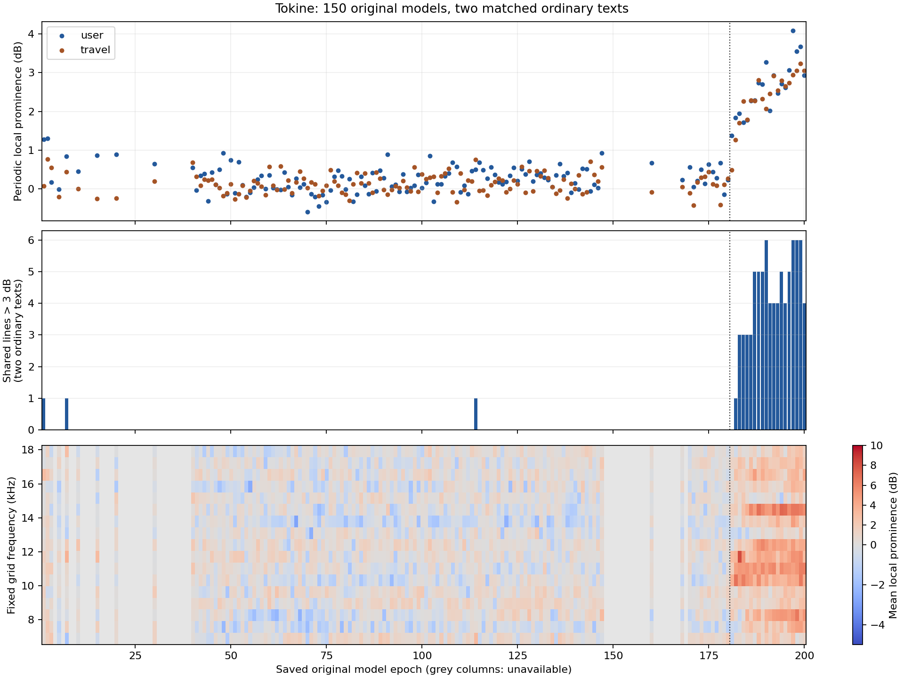

# 180以前を含む周期ノイズ増加の再検査（2026-10-24）

旧モデル系列では181epochに弱い兆候、182epochから明確な固定周波数ピーク、183epoch以降に複数の持続的なピークを確認した。180以前の保存済み130モデルには、同じ持続的な増え方は見つからなかった。高域成分の総量をノイズ量として判定した結果ではない。

## 対象と検証

1〜200epochの保存原本150モデルを通常文2本で検査した（300音声）。140、170、179〜184、200は別の通常文2本でも確認した（18音声、合計318）。すべて旧model_hashes.jsonとのモデルサイズ・SHA256一致を確認し、未補正のまま隔離COEIROINKエンジン50033で生成した。速度1、44.1kHz/16bit/mono、全318音声でPCMクリップ0。母音伸長、EQ、ノイズ除去、推論重み補正は行っていない。本番アプリ・公開ZIPは変更していない。

対象は過去の保存原本系列である。optimizer復元等に問題があった旧181以降と、後日正しく再開した従来再学習200、現在進行中の対照学習を混同しない。今回の境目は、現在の対照学習でも182で悪化することを意味しない。

## 判定方法

既存noise_spectral_detailの母音内フレームを使用。2048点STFT、1536点重複、各フレームの300〜4000Hzエネルギーで規格化し、時間中央値のスペクトルを計算する。既知の櫛状成分の間隔fs/64=689.0625Hz、その10〜26倍（約6.89〜17.92kHz）の17点について、周辺10点の中央値に対する突出度を測る。17点の平均と、異なる通常文で同じ周波数が突出する本数を確認した。高域全体のエネルギー増加、子音の強さだけで雑音と判定しない。

4文での追加確認：

| epoch | 周期ピーク突出度の4文平均 dB | 全4文に共通する3dB超ピーク本数 |
|---:|---:|---:|
| 140 | 0.017 | 0 |
| 170 | 0.185 | 0 |
| 179 | −0.036 | 0 |
| 180 | 0.110 | 0 |
| 181 | 0.728 | 0 |
| 182 | 1.682 | 1 |
| 183 | 1.921 | 3 |
| 184 | 2.236 | 3 |
| 200 | 2.896 | 2 |

共通ピークの閾値を2/3/4dBに変えても、180までは0本、181は1/0/0本、182は4/1/1本、183は3/3/3本となる。181を確実な発症点と断定せず、弱い兆候とする。182では10.3359kHzピークが最初の2文で約6.66/6.97dB突出し、解析母音フレームの約42.5/49.6%で6dB以上の突出を示す。183以降では異なる複数の通常文に共通する線が増える。

180以前の全130保存モデルでは、2通常文に共通する3dB超ピークは1、7、114epochで各1本検出しただけで、2本以上や連続した増加は見つからなかった。したがって「180以前はノイズが一切ない」とは言わない。40〜180の記述的な二分割最小二乗は97/98を選ぶが、平均0.117→0.237dBの小差で、持続する複数ピークを伴わず、ノイズ開始点の証明には使わない。40〜200の同じ計算では181/182が選ばれた。いずれも統計的有意差・因果関係の検定ではない。



## 制約と比較音声

この検査で分かるのは既知の櫛状の固定周波数ノイズの増加であり、息・歯擦音・発音崩れ・歪み等すべての雑音や総合音質を網羅しない。指標はSNRやノイズ割合ではない。初期モデルの別種の欠陥も否定しない。聴感による最終確認は未実施。隣接checkpointは独立標本ではなく、1回ずつの生成による比較である。

58epoch分は保存原本がなく、補間していない。とくに148〜159、161〜167、169などの空白がある。全欠損番号はonset_summary.jsonを参照する。

ローカル成果物は準備フォルダのoutput/talk_full_20260917/noise_onset_20261024。rawに318音声とリクエスト、results.jsonとconfirmation/results.jsonに全測定を保持する。listening/user_100_140_170_180_182_184_200.wavとtravel版は、その順に1秒間隔で連結した比較音声。線形ゲインのみで−23LUFSへ揃え、実測−23.01〜−22.99LUFS、最大−3.88dBTP、サンプル数維持と連結PCM一致を確認した。ノイズを隠す処理はしていない。

## 再現

準備済みnoise_20261021のinventory・model_hashes・隔離runtimeが必要。元の実行環境はtorch/scipyを持つ既存Python、描画は既存matplotlib環境を使用した。追加インストールは行っていない。ROOTとPREVIOUSにローカル検査フォルダを指定する。既存50033が使用中なら起動しない。

```sh
python tools/noise_onset_audit.py --root "$ROOT" --previous "$PREVIOUS"
python tools/noise_onset_report.py "$ROOT"
python tools/noise_onset_plot.py "$ROOT"
python tools/noise_onset_listening.py "$ROOT"
python tools/noise_onset_audit.py --root "$ROOT/confirmation" --previous "$PREVIOUS" --epochs 140 170 179 180 181 182 183 184 200 --texts sibilants current
```

通常文は本人指定の「迷惑かけちゃってごめんね、こんなに長く外にいるつもりはなかったんだよ」、旅行文、静かな朝の文、博士がくれた曲の文。全文はtools/noise_onset_audit.pyと既存noise_audit.TEXTSで固定する。onset_summary.json/CSVは150×2文、confirmation_summary.jsonは境界9モデル×4文の照合結果。
